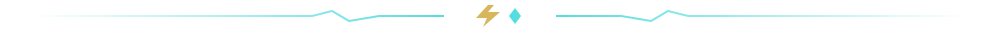
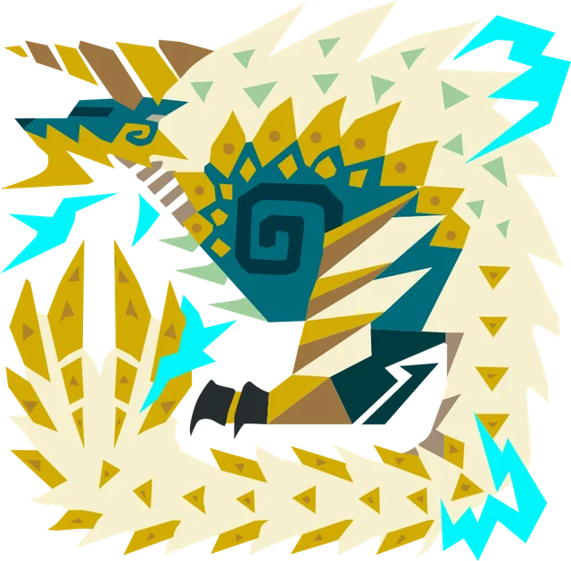

<!--
BRUNO PIMENTEL · ZINOGRE EDITION

Para usar no perfil E3ND:
1. Copie este conteúdo para o README.md do repositório E3ND/E3ND.
2. Adicione a pasta assets deste pacote na raiz do mesmo repositório.
Os caminhos abaixo são relativos ao README.md. As imagens precisam estar no GitHub.
-->

  

  

  DEVELOPMENT &nbsp; / &nbsp; FOCUS &nbsp; / &nbsp; CONSTANT GROWTH
   
  <em>Calm before the surge.</em>

 

# Bruno Pimentel

**Desenvolvedor · Ciência da Computação**

Opa! Eu sou o Bruno. Gosto de transformar ideias em soluções práticas, entender como as coisas funcionam e refinar o que construo.

Sou técnico em **Desenvolvimento de Sistemas pela ETEC de Guaianases** e estou cursando **bacharelado em Ciência da Computação**.

Atualmente, estou aprofundando meus conhecimentos em **React** e **Node.js**, com foco em desenvolvimento web e soluções de backend.

 

## Em foco

- **Estudar** React e Node.js e aplicar o aprendizado em projetos.
- **Explorar** APIs, arquitetura e organização de código.
- **Evoluir** com prática, curiosidade e novos desafios.

> Foco para construir. Constância para evoluir.

## Tech loadout

  

  LINGUAGENS &nbsp; · &nbsp; FRAMEWORKS &nbsp; · &nbsp; FERRAMENTAS

## GitHub stats

  
  

## Conexões

  
  &nbsp;
  
  &nbsp;
  

 

  <em>Built with focus. Charged with purpose.</em>

  

