<!--
BRUNO PIMENTEL · ZINOGRE / NEON EDITION
Copie este arquivo para README.md de E3ND/E3ND e a pasta assets para a raiz.
As bordas e os brilhos fazem parte das imagens SVG; não dependem de CSS no GitHub.
A versão anterior está preservada na pasta anterior do pacote de comparação.
-->

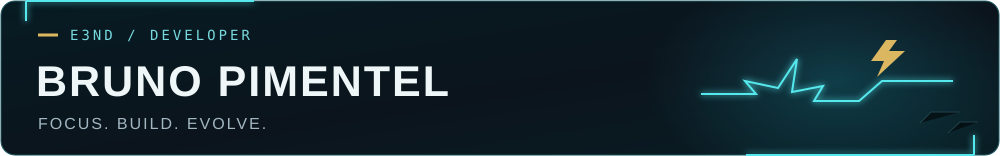

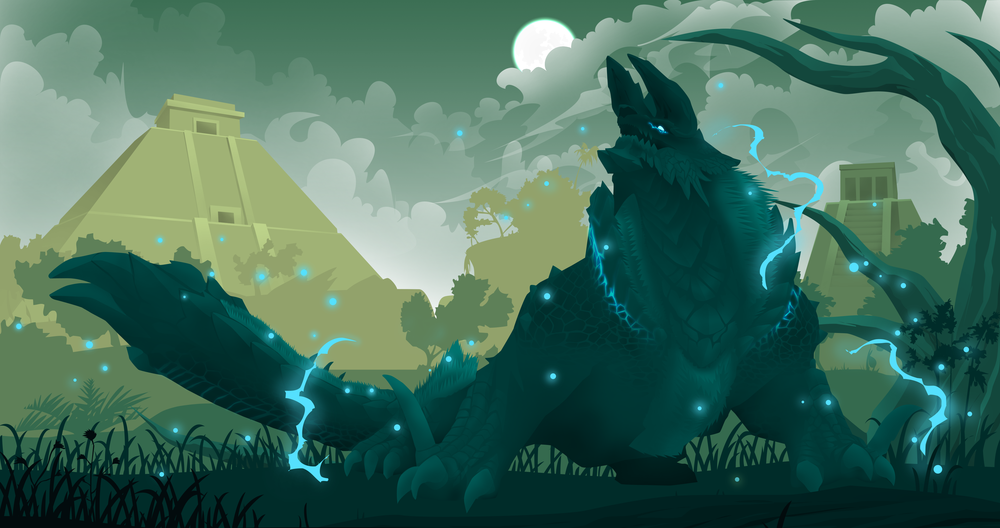

<em>Calm before the surge.</em>

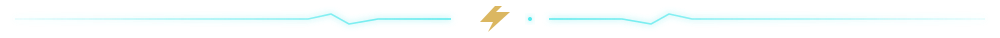

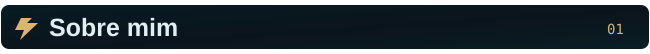

**Opa! Eu sou o Bruno.**

Gosto de transformar ideias em soluções práticas, entender como as coisas funcionam e refinar o que construo.

Sou técnico em **Desenvolvimento de Sistemas pela ETEC de Guaianases** e estou cursando **bacharelado em Ciência da Computação**.

Atualmente, estou aprofundando meus conhecimentos em **React** e **Node.js**, com foco em desenvolvimento web e soluções de backend.

 

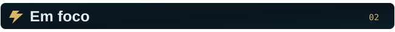

  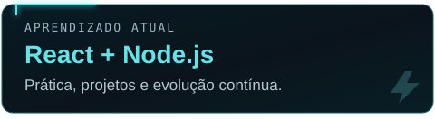
  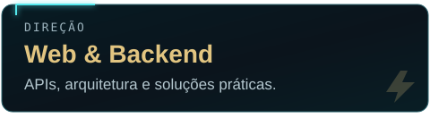

- **Estudar** e aplicar o aprendizado em projetos.
- **Explorar** APIs, arquitetura e organização de código.
- **Evoluir** com prática, curiosidade e novos desafios.

> Foco para construir. Constância para evoluir.

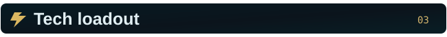

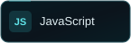
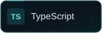
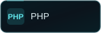
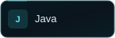
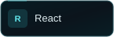
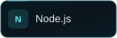
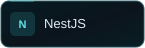
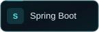
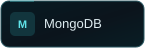
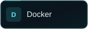
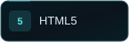
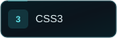

LINGUAGENS &nbsp; · &nbsp; FRAMEWORKS &nbsp; · &nbsp; FERRAMENTAS

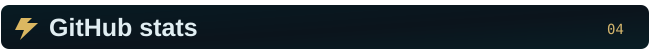

  
  

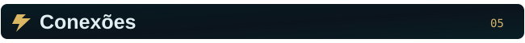

  
  &nbsp;
  <a href="https://www.linkedin.com/in/bruno-pimentel-01b948220">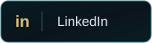</a>
  &nbsp;
  <a href="https://github.com/E3ND">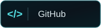</a>

 

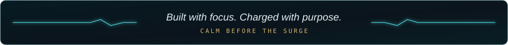

